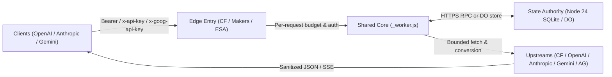

<h1 align="center">
  
</h1>

<p align="center">
  <a href="LICENSE"></a>
  <a href="docs-site/en/docs/index.md"></a>
  <a href="src/self-hosted/server.mjs"></a>
  <a href="docs-site/en/docs/contracts.md"></a>
</p>

<p align="center">
  <a href="README.md">简体中文</a> | <strong>English</strong>
</p>

<p align="center">
  <a href="https://modelbridge.cbnv.me/en/">Docs Site</a> · <a href="#quick-start">Quick Start</a> · <a href="docs-site/en/docs/index.md">Deployment</a> · <a href="repo-docs/README.md">Source Guide (ZH)</a> · <a href="CONTRIBUTING.md">Contributing</a>
</p>

**ModelBridge** is a multi-protocol LLM API proxy and router derived from [WorkersAI2API](https://github.com/cmliussss2024/WorkersAI2API). One shared core exposes **OpenAI, Anthropic, and Gemini** client endpoints across Cloudflare Workers, EdgeOne Makers, Alibaba Cloud ESA, and a self-hosted Node.js 24 + SQLite state service. It does not implement `/v1/responses`, full image/audio media-generation APIs, or exact cross-provider token counting (`:countTokens` returns `501`).

## Capabilities & Architecture Flow

- **Cross-Protocol Translation with Semantic Checks**: Serves `/v1/chat/completions`, `/v1/completions`, `/v1/embeddings`, `/v1/messages`, and `/v1beta/models/*`, preserving tool calls, `strict`, and signed thinking replay metadata while rejecting unrepresentable constraints pre-flight.
- **Single State Authority & 4-Credential Isolation**: Separates `ADMIN_PASSWORD` (24h sessions), client `apiKeys`, upstream credentials, and `MODELBRIDGE_STATE_TOKEN` across self-hosted SQLite transactions or compatibility `AppConfigStore` DO.
- **Deterministic Routing & Bounded Failover**: Resolves `@cf/`, provider prefixes, `upstream:<accountId>:<model>`, and the 65-entry `cloudflare-model-map.json`; fails over across at most 3 candidate accounts only on explicit `401/403/404/429` rejections.
- **Edge Runtime Adapters & Admin Console**: Ships a Primer-styled portal `/` and admin UI `/admin` with per-platform budgets (Cloudflare `16 MiB`, Makers `1 MiB`, ESA `4` subrequests / `9s` first byte / `115s` total).

## Capabilities & Explicit Non-Goals

| Area | What ModelBridge Delivers | Explicit Non-Goals & Hard Bounds |
| --- | --- | --- |
| Multi-Protocol Core | OpenAI (chat/completions/embeddings/models), Anthropic `/v1/messages`, Gemini `/v1beta/models/*` with replay & `strict` checks | **Omits** `/v1/responses`, image/audio media gen, and cross-provider token counting (`:countTokens` returns `501`) |
| State & Credentials | 4-domain secret isolation; transactional Node 24 WAL SQLite or `AppConfigStore` DO; `upstream:<id>:<model>` routing | **No** SQLite/DO dual-write or silent fallback; `modelMap` is not an access-control allowlist |
| Budgets & Failover | Emits 6 bundles (`1 MiB` Makers, `4`-fetch ESA); bounded 3-account failover strictly on `401/403/404/429` | **Never** retries timeouts or `5xx` errors (prevents double billing); 10k Neurons counter is advisory only |



## Quick Start

Run the mocked regression suite and generate all six deployment projects under `dist/` (requires Node.js 24+; no root `pnpm install` needed):

```sh
git clone https://github.com/CyberNova2333/modelbridge.git
cd modelbridge
node --test tests/*.test.mjs
node tools/build-platforms.mjs
```

| Deployment / Mode | Output & Scope | Documentation Entry |
| :--- | :--- | :--- |
| **Self-Hosted State + Remote Gateways (Recommended)** | `dist/self-hosted-state/` shared by `cloudflare-remote`, `edgeone`, `esa` | [Getting Started & Deployment](docs-site/en/docs/index.md) · [Template](deploy/self-hosted-state/README.md) |
| **Cloudflare Workers (Remote State)** | `dist/cloudflare-remote/` without KV or Durable Object bindings | [Multi-Platform Matrix](docs-site/en/docs/index.md#multi-platform-deployment-matrix) · [Template](deploy/cloudflare-remote/README.md) |
| **Cloudflare Workers / Pages (Native DO)** | `_worker.js` + `wrangler.toml` with `AppConfigStore` compatibility | [Native DO & Pages](docs-site/en/docs/index.md#native-cloudflare-do--pages-compatibility) · [Template](deploy/cloudflare/README.md) |
| **EdgeOne Makers / Alibaba Cloud ESA** | `dist/edgeone/` (`1 MiB` limit) and `dist/esa/` (`4`-fetch cap) | [Platform Budgets](docs-site/en/docs/index.md#multi-platform-deployment-matrix) · [Deployment FAQ](docs-site/en/docs/deployment-faq.md) |
| **Offline Migration, Backup & Docs Site** | `tools/state-admin.mjs` and `pnpm --dir docs-site run docs:build` | [Decisions & Migrations](docs-site/en/docs/migrations.md) · [Walkthrough (ZH)](repo-docs/walkthroughs/one-real-run.md) |

## Pre-Adoption FAQ

- **Q: Does ModelBridge support self-hosted Ollama, vLLM, or custom OpenAI-compatible endpoints?**
  Yes. Create an `openai` upstream account in the admin UI with a custom `baseUrl` (public HTTPS, or HTTP loopback for local development) and declare its model IDs; there is no separate Ollama provider type.
- **Q: Should I choose `Node.js 24 + SQLite` or native Cloudflare `DO / KV`?**
  New deployments should use `self-hosted-state` (single-host SQLite + WAL transactions) so Cloudflare, Makers, and ESA share one authority; native DO remains for existing Cloudflare setups, and KV is only migrated once on DO initialization.
- **Q: Do `cloudflare-model-map.json` or the 10,000 Neurons counter enforce hard spending caps?**
  No. The 65 preset aliases and cached 5-minute dashboard counter are discovery and display helpers only, not server-side spending limiters.
- **Q: Will ModelBridge retry another account on timeouts or `5xx` errors?**
  No. To prevent duplicate billing after an upstream may have started generation, failover occurs only on explicit `401`, `403`, `404`, or `429` responses (up to 3 candidates).

## Reading Paths

| Goal | Docs Site (`docs-site/`) | Source Guide (`repo-docs/`, Chinese) |
| :--- | :--- | :--- |
| Deployments, Secrets & Env Matrix | [Getting Started & Deployment](docs-site/en/docs/index.md) · [Deployment FAQ](docs-site/en/docs/deployment-faq.md) | [Platform Adapters & State](repo-docs/modules/platform-adapters.md) |
| Client APIs, Routing & Custom Providers | [API & Routing Contracts](docs-site/en/docs/contracts.md) · [API & Component Reference](docs-site/en/api-reference/index.md) · [Adapters & Extensions](docs-site/en/docs/adapters.md) | [Routing & Protocols](repo-docs/modules/routing-and-protocols.md) · [Upstreams & Quota](repo-docs/modules/upstream-and-quota.md) |
| Request Lifecycle & Code Navigation | [Architecture & Code Tour](docs-site/en/docs/architecture.md) | [One Real Run](repo-docs/walkthroughs/one-real-run.md) · [Code Map](repo-docs/code-map.md) · [Access & Config](repo-docs/modules/access-and-config.md) |
| DO Migration, Backups & ADRs | [Decisions & Migrations (ADR)](docs-site/en/docs/migrations.md) | [Glossary](repo-docs/glossary.md) · [Source Evidence](repo-docs/references/source-evidence.md) · [Change Log](repo-docs/change-log.md) |
| Contributing, Hooks & Security Policy | — | [CONTRIBUTING.md](CONTRIBUTING.md) · [SECURITY.md](SECURITY.md) · [AGENTS.md](AGENTS.md) |

## Acknowledgments & License

Built on [WorkersAI2API](https://github.com/cmliussss2024/WorkersAI2API) and the [Cloudflare](https://www.cloudflare.com/) ecosystem. Licensed under [GNU AGPLv3](LICENSE) (`AGPL-3.0-only`); the original WorkersAI2API MIT copyright and license text are preserved verbatim in [`LICENSES/WorkersAI2API-MIT.txt`](LICENSES/WorkersAI2API-MIT.txt), with provenance notices in [`NOTICE`](NOTICE).
