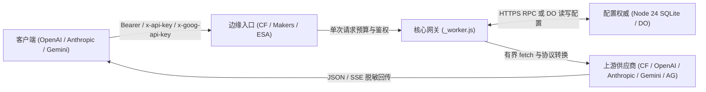

<h1 align="center">
  
</h1>

<p align="center">
  <a href="LICENSE"></a>
  <a href="docs-site/docs/index.md"></a>
  <a href="src/self-hosted/server.mjs"></a>
  <a href="docs-site/docs/contracts.md"></a>
</p>

<p align="center">
  <strong>简体中文</strong> | <a href="README.en.md">English</a>
</p>

<p align="center">
  <a href="https://modelbridge.cbnv.me/">在线文档站</a> · <a href="#quick-start">Quick Start</a> · <a href="docs-site/docs/index.md">部署文档</a> · <a href="repo-docs/README.md">源码指南</a> · <a href="CONTRIBUTING.md">贡献指南</a>
</p>

**模桥（ModelBridge）** 是基于 [WorkersAI2API](https://github.com/cmliussss2024/WorkersAI2API) 演进的多协议 AI API 转发与路由网关，用同一共享核心对外提供 **OpenAI、Anthropic 与 Gemini** 以及多模态任务专用接口（Responses、图像生成/编辑、TTS/ASR/实时语音识别 WebSocket、重排序、翻译、分类与 System One 结构化抽取/决策），支持 Cloudflare Workers、EdgeOne Makers、阿里云 ESA，以及自建 Node.js 24 + SQLite 状态服务。本项目仅拒绝明确不兼容的模型参数与跨供应商精确 token 计数（Gemini `:countTokens` 返回 `501`），不伪造未支持能力。

## 核心能力与主干流程

- **多协议互通与全任务接入**：提供 `/v1/chat/completions`、`/v1/completions`、`/v1/responses`（CF `gpt-oss-120b`/`20b` 与 OpenAI）、`/v1/embeddings`（含 `embeddinggemma-2` 多模态）、`/v1/images/{generations,edits}`、`/v1/audio/{speech,transcriptions,translations,realtime,turn-detection}`、`/v1/rerank`、`/v1/translations`、`/v1/classifications`、`/v1/extractions`、`/v1/decisions`、`/v1/vision`、`/v1/ai/run`、`/v1/messages` 与 `/v1beta/models/*`；`moondream3.1-9B-A2B`、`clairic` 与 `clef*` 支持聊天接口适配，其余非聊天任务发往聊天入口会在生成前以 `400` 拒绝并提示专用端点。
- **单一配置权威与四态凭据隔离**：严格分离 `ADMIN_PASSWORD`（24h 管理员会话）、实例调用密钥（`apiKeys`）、上游供应商凭据与服务间令牌 `MODELBRIDGE_STATE_TOKEN`；支持自建 SQLite 事务权威或兼容 Cloudflare `AppConfigStore` DO。
- **确定性路由与有界容错**：按 `@cf/`、供应商前缀、`upstream:<账号ID>:<模型>` 与 48 条预设映射解析目标；仅在明确的 `401/403/404/429` 拒绝时在最多 3 个匹配账号内切换，超时与 `5xx` 绝不重复生成。
- **跨边缘部署与管理面板**：内置 Primer 风格公共门户 `/` 与控制台 `/admin`，按请求注入体积/流字节预算（Cloudflare `16 MiB`、Makers `1 MiB`、ESA `4` 次出站 fetch / `9s` 首包 / `115s` 总时长）。

## 能做到什么程度与明确不能做什么

| 维度 | 能做到什么程度（已实现能力） | 明确不能做什么（非目标与硬限制） |
| --- | --- | --- |
| 多协议与专用端口 | OpenAI（chat/completions/responses/embeddings/images/audio/models）、Anthropic `/v1/messages`、Gemini `/v1beta/models/*`（含 `moondream` 视觉）及 rerank/翻译/分类/System One/`/v1/ai/run` | **拒绝未支持参数**：CF Responses 禁用流式，CF 图像禁用 `url`/`n>1`/`mask`，Aura TTS 禁用 `speed≠1`，Gemini `:countTokens` 固定 `501`；不伪装兼容不支持字段 |
| 状态与密钥隔离 | 四态密钥完全隔离；自建 SQLite（WAL）与 DO 单权威事务；`upstream:<id>:<model>` 精准路由 | **不做** SQLite 与 DO 双写或运行期静默切换；`modelMap` 不是访问控制白名单 |
| 边缘预算与容错 | 生成 6 套平台产物（Makers 限 `1 MiB`、ESA 限 `4` fetch）；仅在 `401/403/404/429` 切换最多 3 账号 | **不因**超时或 `5xx` 自动重试（防重复计费）；10,000 Neurons 计数器非服务端消费拦截器 |



## Quick Start

本地验证模拟回归并生成六个多平台独立部署目录（`dist/`，需 Node.js 24+，根目录无需安装 npm 依赖）：

```sh
git clone https://github.com/CyberNova2333/modelbridge.git
cd modelbridge
node --test tests/*.test.mjs
node tools/build-platforms.mjs
```

| 部署 / 运行模式 | 适用场景与构建产物 | 详细文档入口 |
| :--- | :--- | :--- |
| **自建状态 + 远程网关（推荐）** | `dist/self-hosted-state/` 搭配 `cloudflare-remote` / `edgeone` / `esa` | [起步与配置部署](docs-site/docs/index.md) · [状态服务模板](deploy/self-hosted-state/README.md) |
| **Cloudflare Workers 远程模式** | `dist/cloudflare-remote/`，无需 KV 或 Durable Object | [多平台部署矩阵](docs-site/docs/index.md#多平台部署矩阵) · [模板](deploy/cloudflare-remote/README.md) |
| **Cloudflare Workers / Pages 原生 DO** | `_worker.js` + `wrangler.toml`，兼容既有 `AppConfigStore` | [原生 DO 与 Pages 兼容](docs-site/docs/index.md#原生-cloudflare-do-与-pages-兼容) · [模板](deploy/cloudflare/README.md) |
| **EdgeOne Makers / 阿里云 ESA** | `dist/edgeone/`（`1 MiB` 限额）与 `dist/esa/`（`4` 次 fetch 预算） | [平台预算与部署](docs-site/docs/index.md#多平台部署矩阵) · [排错 FAQ](docs-site/docs/deployment-faq.md) |
| **离线迁移、备份与本地文档站** | `tools/state-admin.mjs` 及 `pnpm --dir docs-site run docs:build` | [决策与迁移指南](docs-site/docs/migrations.md) · [源码走读](repo-docs/walkthroughs/one-real-run.md) |

## 前置选型 FAQ

- **Q：支持自建 Ollama、vLLM 或其他 OpenAI 兼容后端吗？**
  支持。在后台新增 `openai` 类型账号并填写自定义 `baseUrl`（公网 HTTPS，本地开发允许 HTTP loopback）及声明模型 ID 即可，无需独立的 Ollama 供应商类型。
- **Q：应该选 `Node.js 24 + SQLite` 还是 Cloudflare 原生 `DO / KV`？**
  新部署推荐 `self-hosted-state`（单机本地 SQLite + WAL 事务），可让 Cloudflare、Makers 与 ESA 共用同一配置权威；原生 DO 保留用于既有 Cloudflare 实例，而 KV 仅在 DO 首次初始化时迁移一次。
- **Q：预设免费模型清单和 10,000 Neurons 统计会拦截超额费用吗？**
  不会。`cloudflare-model-map.json` 的 48 条别名和控制台参考额度仅用于发现和展示（5 分钟缓存），不是服务端强制预算拦截器，真实费用以供应商控制台为准。
- **Q：上游超时或返回 `5xx` 时会自动切换账号重试吗？**
  不会。为避免在供应商已计费后重复生成，仅在明确的 `401`、`403`、`404`、`429` 拒绝时尝试下一个匹配账号（最多 3 个候选）；网络中断、超时、5xx 与无效 200 响应直接报错。

## 阅读路线（Reading Paths）

| 读者目标 | 文档站章节（`docs-site/`） | 源码指南（`repo-docs/`） |
| :--- | :--- | :--- |
| 部署、Secret 与环境变量配置 | [起步与配置部署](docs-site/docs/index.md) · [部署排错 FAQ](docs-site/docs/deployment-faq.md) | [多平台与自建状态](repo-docs/modules/platform-adapters.md) |
| 客户端接入、模型映射与扩展开发 | [接口与路由契约](docs-site/docs/contracts.md) · [API 与组件参考](docs-site/api-reference/index.md) · [上游容错与扩展](docs-site/docs/adapters.md) | [模型路由与协议](repo-docs/modules/routing-and-protocols.md) · [上游与配额](repo-docs/modules/upstream-and-quota.md) |
| 一次请求链路、代码定位与安全边界 | [架构全景与源码导览](docs-site/docs/architecture.md) | [主流程走读](repo-docs/walkthroughs/one-real-run.md) · [代码地图](repo-docs/code-map.md) · [访问与配置](repo-docs/modules/access-and-config.md) |
| DO 迁出、容灾备份与架构决策 | [关键架构决策与迁移](docs-site/docs/migrations.md) | [术语表](repo-docs/glossary.md) · [源码证据](repo-docs/references/source-evidence.md) · [变更记录](repo-docs/change-log.md) |
| 贡献代码、提交护栏与安全报告 | — | [CONTRIBUTING.md](CONTRIBUTING.md) · [SECURITY.md](SECURITY.md) · [AGENTS.md](AGENTS.md) |

## 致谢与许可

感谢上游 [WorkersAI2API](https://github.com/cmliussss2024/WorkersAI2API) 项目与 [Cloudflare](https://www.cloudflare.com/) 开源生态。本项目基于 [GNU AGPLv3](LICENSE)（`AGPL-3.0-only`）开源，原 WorkersAI2API 的 MIT 版权与许可文本完整保留在 [`LICENSES/WorkersAI2API-MIT.txt`](LICENSES/WorkersAI2API-MIT.txt)，来源与再分发说明见 [`NOTICE`](NOTICE)。

- **附加条款与资产规则**：本项目依据 GNU AGPLv3 第 7 条适用 [`LICENSE-ADDITIONAL_TERMS-zh-CN.md`](LICENSE-ADDITIONAL_TERMS-zh-CN.md)（英文参考译文：[`LICENSE-ADDITIONAL_TERMS-en.md`](LICENSE-ADDITIONAL_TERMS-en.md)，以简体中文完整版正文为准），对来源陈述、修改标识、禁止冒充、扩展模块有条件附加许可及项目标识边界作出补充说明；工程落地参考见 [`IMPLEMENTATION-GUIDE.zh-en.md`](IMPLEMENTATION-GUIDE.zh-en.md)，人员署名、AI 辅助工具、上游/第三方代码及独立美术字体与标识资产综合清单见 [`ASSETS_LICENSES.md`](ASSETS_LICENSES.md)。附加要求与第 9.5–9.6 款附加许可豁免均分别核实相应版权持有人有效授权，未取得该等授权的第三方或上游材料仍受其原有有效许可约束。
