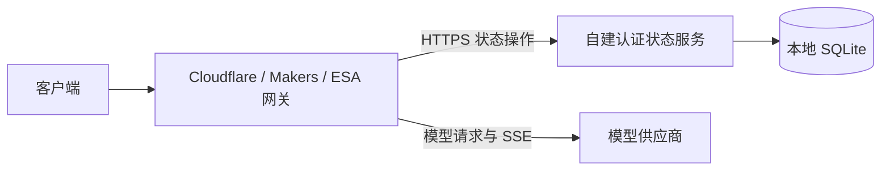

# 三个平台怎样共用一个网关

同一套模型和调用密钥可以由 Cloudflare Workers、EdgeOne Makers 或阿里云 ESA 的入口提供服务。协议转换仍由共享核心处理，入口负责读取 Secret、提供可信客户端身份、控制请求预算；推荐由自建 Node.js 24 + SQLite 服务保存配置、管理员会话和用量缓存。

采用远程状态入口后，三个平台均不需要 Cloudflare DO 或 KV。原生 Cloudflare DO 仍可作为兼容选项，已有实例可显式迁移到自建服务。代码与本地测试不能代替真实平台验收；三个平台的容量和运行时仍有差异。

## 一次调用跨过哪些边界

例如在 Makers 添加账号后，客户端访问该入口的 `/v1/chat/completions`：

1. Makers 入口从服务端环境读取管理员 Secret 和状态服务地址、服务令牌。
2. 共享核心通过状态接口读取当前配置，核对客户端调用密钥，再选择模型与账号。
3. 状态客户端向固定 HTTPS 服务端点发送带认证的操作；状态服务校验令牌、允许的入口 origin、操作范围，再由共享状态引擎访问 SQLite。
4. Makers 直接请求模型供应商，转换结果并返回客户端。模型生成流不经过状态服务。

管理员删除调用密钥后，下一次请求重新读取权威配置，不从新平台的 KV 或跨请求缓存恢复旧密钥。同一次请求可以复用自己的配置快照，已经开始的请求不因此被主动撤销。SQLite 事务覆盖完整的配置、会话读改写；不同入口不能各自写一份独立数据库。

[共享核心](../../_worker.js)的 `createGateway` 接收 `state.request`、请求级 `fetch`、客户端身份和输入预算；不在模块全局切换当前请求的依赖。[远程通道](../../src/state/remote.mjs)实现同一状态接口，[认证服务](../../src/state/service.mjs)将验证后的操作转交持久化实现。模型生成流不绕经自建服务器，因此状态服务不需要承担生成带宽。



## 四种凭据不能互换

| 凭据 | 放在哪里 | 权限 |
| --- | --- | --- |
| `ADMIN_PASSWORD` | 每个网关入口的服务端 Secret | 管理员登录；会话继续按入口 origin 和密码指纹隔离 |
| 实例调用密钥 | 客户端 | 调用模型接口 |
| 上游凭据 | 权威配置 | 请求对应模型供应商 |
| `MODELBRIDGE_STATE_TOKEN` | 状态服务和获授权的网关入口 Secret | 读取完整配置、提交配置及会话操作，属于高权限服务凭据 |

服务令牌采用独立生成的高熵随机值，不能使用管理员密码或实例调用密钥。它通过 HTTPS Bearer 认证，使远端网关具有读写完整状态的权限；此方案不提供被盗 Bearer 的防重放保证。允许的 origin 是额外范围限制，不是代替令牌的认证措施。不同信任域应部署独立状态服务及独立令牌；共享同一服务令牌的入口有相同的配置权限。

状态服务必须配置 `MODELBRIDGE_STATE_ORIGINS`，为逗号分隔的精确 HTTPS origin，例如 `https://gateway.example,https://other.example`，不能使用通配符或路径。会话操作的 scope 必须与这个 origin 匹配。服务只接受固定配置、会话、用量操作，不代理任意 URL、存储键、SQL 或 DO 名称，不开放浏览器 CORS，不自动重试结果不确定的写入。

## 平台预算怎样影响请求

| 入口 | 实现预算与行为 | 使用时的影响 |
| --- | --- | --- |
| Cloudflare 原生入口 | 保留原有 16 MiB 业务输入、120 秒上游响应头及闲置超时、32 MiB 上游响应累计限制 | 保持现有绑定和迁移路径 |
| Cloudflare 远程状态入口 | 复用原有业务限制；强制使用配置的 HTTPS 状态服务 | 无需 KV/DO，远程服务失败时不回退原生绑定 |
| Makers Edge Functions | 输入最多 1 MiB，仍受更小的登录/管理输入限制；取消信号及流按运行时能力处理 | 长历史、内嵌图片可能先被平台拒绝；不能通过修改应用常量解除平台限制 |
| ESA | 每次最多 4 个出站 fetch，包含状态查询、OAuth 和上游调用；应用采用 9 秒首个响应数据、115 秒总时长预算 | 复杂准备过程和多账号尝试可能提前耗尽预算；慢响应、长流会失败，不切换账号重新生成 |

ESA 出站地址还必须符合域名、HTTP 80 / HTTPS 443 和 URL 长度限制。流在返回前预读首个非空数据块；已开始后到达总时长上限会中断，不伪造成功终止或补发生成。输入读取、出站连接与响应流会接收组合后的客户端取消和应用截止信号；本地取消仍不证明上游停止计算或计费。

Cloudflare 账号连接测试需要三次上游探针。ESA 编辑已有账号时，管理员会话验证及账号读取已消耗两次状态 fetch，剩余预算不足；网关在发送任何探针前返回 503 `platform_subrequest_limit`，不会先执行付费向量测试再把预算失败显示为供应商权限不足。新账号若仍有三次预算可继续诊断；真实权限仍以诊断结果为准。

Makers 读取运行时的 `request.eo.clientIp`。ESA 尚未确认不可伪造的入站客户端 IP 来源，因此使用共享登录限流桶；Makers 缺少可信元数据时也回退共享桶。客户端填写的 `CF-Connecting-IP` 或 `X-Forwarded-For` 不用于这两个入口的身份判定。Cloudflare 远程入口仅在存在 `request.cf` 运行时元数据时使用校验后的 `CF-Connecting-IP`，否则也使用共享桶。共享桶防止通过伪造头绕过限流，也会让用户相互影响。

适配器要求原生 `request.signal` 和 `AbortController`；缺失时返回 503，不用空信号冒充取消支持。具备 API 形状仍不证明真实断连能传到上游，需要部署验收。

路由返回响应后，适配器会取消未消费的上传体；这同样覆盖成功的页面和 OPTIONS 响应，避免客户端继续上传没有用途的数据。HEAD 的成功与平台错误响应都只保留状态及响应头，不发送 JSON 或页面正文。

外部规格核对于 2026-11-02：[Makers Edge Functions](https://pages.edgeone.ai/document/edge-functions)、[ESA 函数限制](https://help.aliyun.com/zh/edge-security-acceleration/esa/user-guide/what-is-functions-and-pages/)、[ESA Fetch](https://help.aliyun.com/zh/edge-security-acceleration/esa/user-guide/fetch-1)。Makers 的 CPU 200 ms 不含 I/O，不能解释成流只能持续 200 ms；本文没有承诺未经确认的 Makers 流时长。

## 准备部署产物

在仓库根目录使用 Node.js 24+，不需要安装根目录 npm 依赖：

```sh
node tools/build-platforms.mjs
```

构建生成六个部署项目，包含模板和各自 README，不读取本地 Secret，也不安装依赖或发布：

| 产物 | 用途 |
| --- | --- |
| `dist/self-hosted-state/` | 自建 Node.js + SQLite 服务，含 Docker Compose、Caddy HTTPS 和迁移工具 |
| `dist/cloudflare-remote/` | Cloudflare 网关使用远程状态服务，不绑定 KV/DO |
| `dist/cloudflare/` | 原生 Cloudflare 网关，配置自己的 KV、DO 和管理员 Secret |
| `dist/state-service/` | 可选 DO 桥接服务，供兼容部署或从旧实例迁移 |
| `dist/edgeone/` | Makers 可构建项目；函数入口与 `public/` 静态目录隔离 |
| `dist/esa/` | ESA 纯函数项目，不启用 SPA 静态回退 |

重建前会检查完整输出目录，拒绝无关文件、符号链接及具有多个硬链接的文件，避免改写目录外的同一文件。CLI 已生成额外元数据时使用新的 `--out-dir`；输出目录不应由其他进程同时修改。

新用户按[自建服务步骤](../../deploy/self-hosted-state/README.md)准备服务与持久磁盘，再选择[Cloudflare 远程入口](../../deploy/cloudflare-remote/README.md)、[Makers](../../deploy/edgeone/README.md)或[ESA](../../deploy/esa/README.md)。部署相同源码不会自动共享状态，所有入口必须指向选定的同一状态服务。

各网关配置自己的 `ADMIN_PASSWORD`、同一 `MODELBRIDGE_STATE_TOKEN`，以及完整固定端点 `MODELBRIDGE_STATE_URL=https://state.example/_modelbridge/state`。只把这些值放入运行时 Secret，不能用前端构建变量把它们打包到浏览器。

Makers 应以项目模式构建函数，静态输出只能是 `public/`；不能将包含 `app/` 源码的整个产物目录作为静态站上传。三个网关入口都保留 `/`、`/admin`、`/api/*`、`/v1/*` 和 Gemini 路径。部署细节以构建附带的说明为准，源模板分别见 [Cloudflare](../../deploy/cloudflare/README.md)、[状态服务](../../deploy/state-service/README.md)、[Makers](../../deploy/edgeone/README.md)、[ESA](../../deploy/esa/README.md)。

## 自建服务怎样保存状态

[SQLite 实现](../../src/state/sqlite.mjs)使用 Node.js 内置 `node:sqlite`，不需要 npm 数据库依赖。数据库父目录必须预先建立；新文件使用 `0600`，已有文件权限不自动调整。启用 WAL、`synchronous=FULL`，并以应用标记和 schema 版本拒绝误用其他数据库。配置与会话读改写由 `BEGIN IMMEDIATE` 事务包住；同连接操作排队，其他连接争用写锁时异步等待，默认最多 5 秒，失败回滚。不在事务中等待模型或统计网络请求。

例如入口 A 删除 K，同时入口 B 保存映射：两次事务依次读取当前配置，仅修改各自字段，最终映射更新且 K 仍被撤销。会话也落到数据库，正常重启不会清空登录、退出状态或限流记录。统计请求在锁外执行，回来后重查当前账号，避免网络等待阻塞管理写入。完整业务语义由 `GatewayStateStore` 共享，原 `AppConfigStore` 只为原生 DO 保留旧 KV 首次迁移。

共享用量刷新不继承首个订阅者的取消上下文：入口 A 断连不会中断仍在等待的 B。所有订阅者离开后，已开始的统计仍由自己的网络界限收束；SQLite 宿主对每次统计 HTTP 请求限制完整响应头及响应体共 15 秒、响应最多 16 MiB，关闭存储时取消这些任务并排空。15 秒不是整批上限，每批仍受账号数、并发数和凭据尝试数限制。远程状态操作的单次取消信号与父请求信号同时生效，不能覆盖父请求的截止范围。

[Node HTTP 宿主](../../src/self-hosted/server.mjs)默认只监听 `127.0.0.1:8788`，公网通过 HTTPS 反代访问。`MODELBRIDGE_STATE_PUBLIC_ORIGIN` 固定对外地址；服务不相信 HTTP Host 或转发头来选取这个地址。`DB_PATH` 指向本地持久磁盘，服务令牌可由环境或 `_TOKEN_FILE` 文件提供，二者不能同时配置。请求体最多 2 MiB，响应最多 16 MiB，主机请求预算 12 秒；断连和截止信号传到状态操作，但响应丢失仍可能发生在提交之后，因此不能自动重试写入。

宿主在读取上传体前验证请求头中的服务令牌；缺失或错误令牌立即返回 401，不等待声明的正文。CONNECT、Upgrade 和 HTTP 解析错误被拒绝后，连接有独立的强制关闭期限，客户端保留写半边不能使这些连接无限占用。它们属于资源与生命周期保护，不增加服务令牌的权限。

自建 SQLite 单条状态记录和远程响应上限为 16 MiB；这不代表原生 DO 具有相同容量。仓库使用 SQLite 后端的 DO，其 key 与 value 合计受 [Cloudflare 的 2 MB 平台限制](https://developers.cloudflare.com/durable-objects/platform/limits/)约束。配置仍以一条记录保存，远程读取也返回完整配置；达到字节上限不等于该规模已通过生产性能验收。

本实现面向单机部署。SQLite 多连接及独立进程争用同一文件的正确性有测试，但不据此承诺多进程的用量刷新合并或高可用；生产推荐一个服务进程。不把 SQLite 放在 NFS/SMB，也不为各节点复制一份数据库分别写入。扩展到多机时应增加事务数据库实现，并重跑同样的撤销、会话、冲突与重启断言；目前没有实现 PostgreSQL 后端。

数据库、WAL、备份和导出文件包含完整凭据。应用不提供静态加密，磁盘加密、Windows ACL、备份保留及恢复演练由部署方配置。自建服务故障会影响所有入口的鉴权和管理，模型请求与状态服务的故障边界应分别监控。

容器运行文件系统不保留 npm、Corepack 或 Yarn；自建服务直接运行 Node 内置模块，容器内的启动与维护命令使用 `node`。Caddy 模板的 HTTPS 入口只启用 HTTP 1.1，以缓解已核实的 Go HTTP/2 协议层漏洞；该限制只影响状态 RPC，模型流仍走边缘入口。重新启用 h2/h3 前应更新并审计实际代理二进制，再验证 TLS 协商；改变协议配置不等于修复镜像内的全部组件。

## 从已有 DO 切换时怎样避免旧密钥复活

迁移是显式维护操作，应用不会自动切换或双写。以下命令只处理配置快照，不能证明迁移期间旧端已停止写入：

1. 备份并冻结旧网关的管理写入，等待在途写入完成；最终切换前停用旧入口，避免旧端继续接受新端撤销的密钥。
2. 如果来源是 DO，先部署[可选桥接服务](../../deploy/state-service/README.md)，准确绑定现有 Worker 的 `AppConfigStore` 和 `app-config-v1`，不能导出旧 KV 或新建的空 DO。给迁移工具设置来源的 `MODELBRIDGE_STATE_URL`、`MODELBRIDGE_STATE_TOKEN`、允许的 `MODELBRIDGE_STATE_EXPORT_ORIGIN`。
3. 导出到受控目录，仅向尚未使用的 SQLite 库导入，再启动服务和新入口。导入保留账号、调用密钥及映射，不复制旧管理员会话或用量缓存。

```sh
node tools/state-admin.mjs export-remote --out /private/modelbridge-config.json
node tools/state-admin.mjs import --db /data/modelbridge.sqlite --file /private/modelbridge-config.json
```

导出文件采用 `modelbridge-state-config-v1` 格式，包含导出时间和配置；工具不把内容打印到终端。已有输出文件绝不覆盖；数据库有任意业务状态时拒绝导入，没有 `--force` 或合并选项。若新服务已经初始化空配置，应重新选择确实未使用的数据库文件，不能清空现有库绕过保护。配置文件必须来自当前权威，工具无法凭快照判断来源是否仍有并发写入。

迁移文件允许 16 MiB 加 1 KiB：额外空间只供格式、时间等封装元数据使用，内部配置的 JSON 字节数仍不得超过 16 MiB，超限会在创建目标数据库前拒绝。这样达到状态上限的合法配置仍能完整导出再导入；导出工具没有放宽状态传输或存储限制。

切换后检查模型列表、每个入口的登录、一次调用和密钥撤销；确认旧入口及桥接令牌不再用于写入。需要回滚时，先核对切换以来的新增、撤销和凭据更换，不能直接恢复一份过期快照作为当前权威。

在线备份使用 SQLite 一致性快照，生成独立数据库文件；不要只复制正在写入的主文件：

```sh
node tools/state-admin.mjs backup --db /data/modelbridge.sqlite --out /private/modelbridge-backup.sqlite
```

备份工具验证应用标记与数据库完整性，用受限临时文件完成备份后独占创建目标；目标文件系统需要支持硬链接，已有目标不覆盖。数据库恢复属于离线维护，可能恢复旧会话和已撤销密钥，必须核对状态并按需要轮换凭据。参考 [Node SQLite API](https://nodejs.org/docs/latest-v24.x/api/sqlite.html) 与 [SQLite 事务说明](https://sqlite.org/lang_transaction.html)。

恢复时先停止服务，将备份复制到全新的数据库路径或数据卷，设置服务账号权限，再调整 `DB_PATH` 并重启。不要直接覆盖仍有旧 WAL/SHM 侧文件的数据库路径。保留原数据用于核对，确认备份时间点之后的撤销与凭据更换已处理，再开放入口；恢复备份本身不会自动合并之后的变更。

数据库打开和备份来源均拒绝具有多个硬链接的主文件。硬链接别名可能只指向同一个主文件，却找不到原路径对应的 WAL，造成“备份成功”但遗漏最新撤销等状态；不要用硬链接给数据库创建别名或代替备份。备份工具内部的临时硬链接仅用于独占发布已经完成且不依赖 WAL 的快照，完成后会移除临时名字，最终输出只有一个链接。数据库目录仍应只允许服务账号和获授权维护者修改，不能在运行期间替换文件或增加别名。

## 怎样验证兼容范围

```sh
node --test tests/*.test.mjs
```

原有协议测试继续执行；平台测试检查状态和网络隔离、服务认证与 origin 范围、真实字节预算、取消、首字节及总时长、子请求预算和构建入口。自建测试使用真实临时 SQLite、独立进程和本地 HTTP；三个网关入口共同验证生成、SSE、会话重启及跨入口撤销。模型供应商仍为模拟，HTTP 测试不证明公网 TLS 或厂商运行时行为。

仓库另提供显式运行的部署验收工具。它们不属于默认单元测试，需要 Docker Linux 引擎或下载指定版本的厂商 CLI；不会登录、上传或发布项目：

```sh
pnpm run verify:container -- --keep-image
# 用上一命令报告中的 image 值替换下面的占位值。
pnpm run verify:tls -- --state-image <IMAGE_FROM_PREVIOUS_REPORT>
pnpm run verify:edge-builds
# 可选：用隔离 Linux 容器增加 ESA 官方 CLI + EW2 本地检查。
pnpm run verify:edge-builds -- --esa-docker
```

容器验收使用新的数据库卷、合成凭据和专属 Docker 内网，不发布主机端口，检查非 root/只读容器运行、运行文件系统没有包管理器、数据库重启、密钥与会话撤销、在线备份，以及另一新卷恢复到准确时间点。TLS 验收在同样隔离的内网中运行生产 Caddy 模板，仅为测试加上内部 CA；客户端验证真实证书链、主机名、协议协商、认证及状态读写。混合提供 h2 和 HTTP 1.1 时必须选 HTTP 1.1，仅提供 h2 时不得协商到 h2。它不会把 CA 加入宿主机信任库，也不会申请公网证书。两个工具只清理核对过归属标签的自有资源；`--keep-image` 保留的测试镜像由维护者在后续使用完成后按报告中的精确名称删除。

厂商工具的结果要按平台分别读：Wrangler 本地 `--dry-run` 验证编译和导出，不证明云端绑定、域名或访问权限；Makers 若没有官方纯本地构建命令，不能用通用 JavaScript 打包替代；ESA 本地模拟器与云端运行时的差异也要保留。实际运行版本和分平台结果见[同步记录](../change-log.md)。

厂商 CLI 工具使用白名单子进程环境、隔离配置与固定版本，并把报告和日志留在输出的系统临时目录。Wrangler 本地 smoke 仅向回环地址检查路由，允许其自动生成的 localhost 证书；该检查不作为 TLS 信任证据，完整证书校验由上面的独立 TLS 工具执行。没有官方本地验收能力的平台会在报告中显示未验证，不会尝试匿名发布或账户登录。

CLI 安装禁用依赖生命周期脚本，使用所需平台的预构建可选组件；执行 CLI 本身仍是在运行供应商代码，隔离 HOME 和环境变量不是操作系统沙箱。每次验收保留实际解析的锁文件及 registry 完整性摘要：主机为临时目录的 `tools/pnpm-lock.yaml`，ESA 容器为 `audit/esa-pnpm-lock.yaml`。顶层 CLI 版本固定不代表传递依赖跨次完全相同；这些锁文件记录该次解析结果，不是仓库长期锁定，也不是已通过漏洞审计的声明。

当前 ESA 官方本地 EW2 可以构建并加载本项目入口，具有所需 Web API，但 `dev` 未提供云端环境变量的第三个 `env` 参数。因此缺配置时的 503 和运行时能力探针不代表状态服务端到端已通过 ESA 云端验收。Makers 仍需在明确授权的实际项目中验证；CLI 的匿名 `deploy` 也属于发布，不能当作本地检查。

工具边界依据 [Wrangler 命令](https://developers.cloudflare.com/workers/wrangler/commands/workers/)、[Makers CLI](https://pages.edgeone.ai/document/edgeone-cli) 和 [ESA 官方本地开发实现](https://github.com/aliyun/alibabacloud-esa-cli/blob/master/src/commands/dev/index.ts)。ESA 验收固定 EW2 版本及 SHA-256，摘要变化时拒绝执行；官方运行时下载通道的摘要匹配不作为供应商签名认证。Caddy 测试使用[内部 CA](https://caddyserver.com/docs/caddyfile/directives/tls)，生产仍使用可被云平台信任的 HTTPS 证书。

生产验收必须另外检查：部署磁盘持久化和恢复、跨入口撤销、真实 SSE 首字节与分块、断连传播、平台日志查询参数脱敏、出网目标和上游账号权限。尚未验收的能力不能仅凭 Node 测试标成支持。测试与构建的实际执行结果见[同步记录](../change-log.md)。

## 怎样读取依赖审计结果

网关与自建服务没有运行时包依赖，但依赖边缘平台运行时、Node 内嵌 SQLite/OpenSSL、容器操作系统与 HTTPS 代理。文档站、厂商 CLI、CI Actions 属于另外的构建与维护范围。文档站 `pnpm audit` 为零，不能推导这些范围同样为零。

审计应记录实际版本、镜像 digest、锁文件和日期，再结合入口判断影响。例如基础镜像自带 npm 的 Undici 不等于 Node 内置 `fetch`；Go HTTP/2 解析发生在 RPC Bearer 认证之前；CLI 的压缩包解压漏洞也不等于状态服务可被远程利用。组件回移补丁时版本字符串可能未变，需查供应商公告和实际修复；扫描器与发行版说明有冲突时保留未确认状态，不能自行忽略告警。当前已知项、缓解及未消除的依赖风险见[最后一轮审查记录](../change-log.md)。

证据状态：本地实现、SQLite 与 HTTP 集成已提供；公网与云平台运行行为仍待真实部署验收，实际测试结果以同步记录为准。
